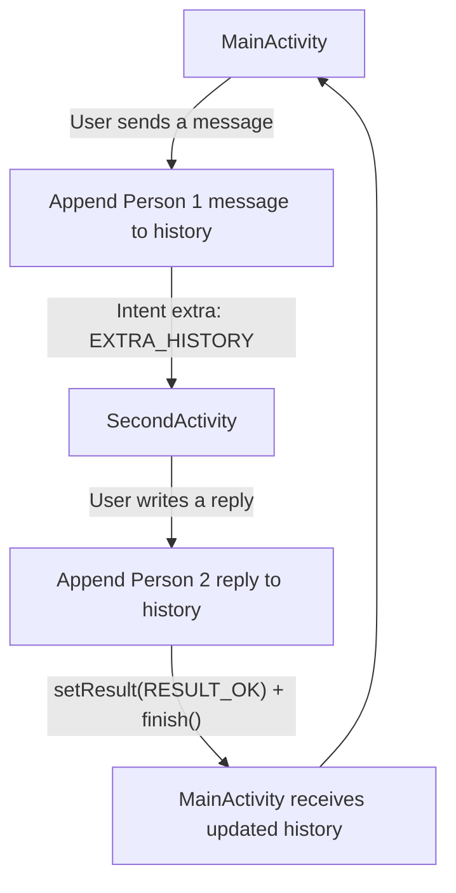

# NextSent Android

<p align="center">
  <strong>A hands-on Android project for learning Activities, Intents, and two-way message passing.</strong>
  <br />
  Built with Java, Android SDK, and Material Components.
</p>

<p align="center">
  
  
  
</p>

NextSent Android is a classroom learning project that demonstrates how two Android Activities can exchange messages and return updated conversation history. It also includes a persistent light/dark theme toggle and supporting material about implicit Intents and intent filters.

## Contents

- [Overview](#overview)
- [Features](#features)
- [How Message Passing Works](#how-message-passing-works)
- [Android Concepts](#android-concepts)
- [Project Structure](#project-structure)
- [Requirements](#requirements)
- [Run the App](#run-the-app)
- [Learning Resources](#learning-resources)
- [Scope and Limitations](#scope-and-limitations)

## Overview

The app has two screens:

- **MainActivity** — lets the user enter a message and displays the conversation history.
- **SecondActivity** — continues the conversation by accepting a reply and returning the updated history to the first screen.

The message history is passed between Activities through Intent extras and an Activity result. The interface also includes a switch for navigating between the screens and a theme button whose preference is saved on the device.

## Features

- **Two-way message flow:** send messages from the first screen and replies from the second.
- **Conversation history:** display messages from both participants in a scrollable view.
- **Explicit Intents:** navigate between the app's Activities.
- **Intent extras:** pass conversation data between screens.
- **Activity results:** return updated history to the calling Activity.
- **Input validation:** prevent empty messages or replies from being added.
- **Persistent light and dark themes:** remember the selected theme using SharedPreferences.
- **Learning references:** includes course materials about Activities, Intents, and intent filters.

> **Note:** NextSent is an educational demo. It is not a real messaging service and does not send messages over the internet.

## How Message Passing Works



1. The user enters a message on the main screen.
2. MainActivity adds the message to the conversation history and opens SecondActivity.
3. SecondActivity displays the history and accepts a reply.
4. The reply is added to the history. SecondActivity returns the updated text with an Activity result and closes.
5. MainActivity receives and displays the updated history.

The current conversation is held in app memory and passed between Activities. It is not stored in a database or synchronized with another device.

## Android Concepts

| Concept | How it is used |
| --- | --- |
| Activities | MainActivity and SecondActivity represent the two screens. |
| Explicit Intents | Open the target Activity inside this app. |
| Intent extras | Carry conversation history between Activities. |
| Activity results | Return the updated history to the calling screen. |
| SharedPreferences | Save the selected light/dark theme locally. |
| AppCompatDelegate | Apply the selected theme. |
| Material Components | Provide the screen-switch control. |
| Implicit Intents and intent filters | Covered in the accompanying learning material. |

## Project Structure

```text
NextSentAndroid/
├── app/
│   └── src/
│       └── main/
│           ├── java/com/nextsent/android/
│           │   ├── MainActivity.java
│           │   ├── SecondActivity.java
│           │   └── ThemeManager.java
│           ├── res/
│           │   └── layout/
│           │       ├── activity_main.xml
│           │       └── activity_second.xml
│           └── AndroidManifest.xml
├── docs/
│   ├── Materi_Mobile_6.pdf
│   └── Materi_Mobile_7.pdf
├── build.gradle.kts
├── settings.gradle.kts
└── README.md
```

## Requirements

The current project configuration specifies:

- **Android Studio** with Android SDK 36 installed.
- **Java 17** compatibility.
- **Minimum Android version:** Android 8.0 (API 26).
- An Android emulator or a physical Android device for running the app.

Gradle and Android Gradle Plugin versions are defined in the repository's build configuration. Use the included Gradle Wrapper so the project uses its configured Gradle version.

## Run the App

### Using Android Studio

1. Clone the repository:

   ```bash
   git clone https://github.com/jasonhukom/NextSentAndroid.git
   ```

2. Open the cloned folder in Android Studio.
3. Let Android Studio sync the Gradle project and install any requested SDK components.
4. Start an emulator or connect an Android device running Android 8.0 or later.
5. Select **Run** to build and launch the app.

### Build from the command line

On Windows:

```bat
gradlew.bat assembleDebug
```

On macOS or Linux:

```bash
./gradlew assembleDebug
```

If the build succeeds, Gradle generates a debug APK under `app/build/outputs/apk/debug/`.

## Learning Resources

- [Module 6: Activities, Intents, and two-way messaging](docs/Materi_Mobile_6.pdf)
- [Module 7: Implicit Intents and intent filters](docs/Materi_Mobile_7.pdf)
- [Android source code](https://github.com/jasonhukom/NextSentAndroid)

The PDFs are included as course references. The app itself focuses on the two-Activity message-passing demonstration; the implicit Intent and intent-filter concepts are covered by the learning materials.

## Scope and Limitations

- Messages are exchanged locally between Activities in the same app.
- There is no network messaging, multi-user chat, backend service, or cross-device synchronization.
- Conversation history is not persisted across a full app restart.
- The light/dark theme preference is stored locally on the device.

## Author

**Jason Christopher Hukom**

---

<p align="center">
  Built for learning Android development, one Intent at a time.
</p>
